# 🎨 GoF Design Patterns

One home for all **23 Gang of Four design patterns**, with an introduction,
three categories, and 23 independently testable Gradle modules. Examples target
**Java 21**, with Spring Boot where it makes a pattern clearer and plain Java
where framework machinery would get in the way.

Start with the [introduction](introduction/README.md), then choose a family:

| Family | Focus | Guides |
| --- | --- | --- |
| Creational | Object creation | [5 patterns](creational/README.md) |
| Structural | Object composition | [7 patterns](structural/README.md) |
| Behavioral | Object collaboration | [11 patterns](behavioral/README.md) |

## The 23-pattern map

```mermaid
flowchart TD
    GoF["GoF Design Patterns"]
    GoF --> C["Creational · object creation"]
    GoF --> S["Structural · object composition"]
    GoF --> B["Behavioral · object collaboration"]

    C --> C1["Singleton"]
    C --> C2["Factory Method"]
    C --> C3["Abstract Factory"]
    C --> C4["Builder"]
    C --> C5["Prototype"]

    S --> S1["Adapter"]
    S --> S2["Bridge"]
    S --> S3["Composite"]
    S --> S4["Decorator"]
    S --> S5["Facade"]
    S --> S6["Flyweight"]
    S --> S7["Proxy"]

    B --> B1["Chain of Responsibility"]
    B --> B2["Command"]
    B --> B3["Interpreter"]
    B --> B4["Iterator"]
    B --> B5["Mediator"]
    B --> B6["Memento"]
    B --> B7["Observer"]
    B --> B8["State"]
    B --> B9["Strategy"]
    B --> B10["Template Method"]
    B --> B11["Visitor"]
```



## Explore a category

- [🎨 Creational](creational/README.md) — Singleton, Factory Method, Abstract Factory, Builder, Prototype.
- [🧱 Structural](structural/README.md) — Adapter, Bridge, Composite, Decorator, Facade, Flyweight, Proxy.
- [🤝 Behavioral](behavioral/README.md) — Chain of Responsibility, Command, Interpreter, Iterator, Mediator, Memento, Observer, State, Strategy, Template Method, Visitor.

Each category guide links to its pattern chapters. Every pattern module includes
an implementation, tests, and an explanation.

## Build and test

Install JDK 21, then run from this repository root:

```sh
./gradlew test
./gradlew build
./gradlew :structural:adapter:test
```

The Gradle Wrapper pins Gradle 9.8.1 and verifies the distribution checksum.
