# 🎨 GoF Design Patterns

One home for all **23 Gang of Four design patterns**, with an introduction,
three categories, and 23 independently testable Gradle modules. Examples target
**Java 21**, with Spring Boot where it makes a pattern clearer and plain Java
where framework machinery would get in the way.

Start with the [introduction](introduction/README.md), then explore the patterns
by family:

| Family | Focus | Guide |
| --- | --- | --- |
| Creational | Object creation | [Creational patterns](creational/README.md) |
| Structural | Object composition | [Structural patterns](structural/README.md) |
| Behavioral | Object collaboration | [Behavioral patterns](behavioral/README.md) |

## The 23-pattern map

```mermaid
flowchart TD
    GoF["GoF Design Patterns"]
    GoF --> C["Creational · object creation"]
    GoF --> S["Structural · object composition"]
    GoF --> B["Behavioral · object collaboration"]

    C --> C1["Singleton"]
    C --> C2["Factory Method"]
    C --> C3["Abstract Factory"]
    C --> C4["Builder"]
    C --> C5["Prototype"]

    S --> S1["Adapter"]
    S --> S2["Bridge"]
    S --> S3["Composite"]
    S --> S4["Decorator"]
    S --> S5["Facade"]
    S --> S6["Flyweight"]
    S --> S7["Proxy"]

    B --> B1["Chain of Responsibility"]
    B --> B2["Command"]
    B --> B3["Interpreter"]
    B --> B4["Iterator"]
    B --> B5["Mediator"]
    B --> B6["Memento"]
    B --> B7["Observer"]
    B --> B8["State"]
    B --> B9["Strategy"]
    B --> B10["Template Method"]
    B --> B11["Visitor"]
```



## All 23 patterns

Every pattern below links directly to its chapter, example, and tests.

### 🎨 Creational — object creation

- [Singleton](creational/dp-singleton/singleton.md)
- [Factory Method](creational/dp-factory/factory.md)
- [Abstract Factory](creational/dp-abstract-factory/abstract-factory.md)
- [Builder](creational/dp-builder/builder.md)
- [Prototype](creational/dp-prototype/prototype.md)

### 🧱 Structural — object composition

- [Adapter](structural/adapter/README.md)
- [Bridge](structural/bridge/README.md)
- [Composite](structural/composite/README.md)
- [Decorator](structural/decorator/README.md)
- [Facade](structural/facade/README.md)
- [Flyweight](structural/flyweight/README.md)
- [Proxy](structural/proxy/README.md)

### 🤝 Behavioral — object collaboration

- [Chain of Responsibility](behavioral/chain-of-responsibility/README.md)
- [Command](behavioral/command/README.md)
- [Interpreter](behavioral/interpreter/README.md)
- [Iterator](behavioral/iterator/README.md)
- [Mediator](behavioral/mediator/README.md)
- [Memento](behavioral/memento/README.md)
- [Observer](behavioral/observer/README.md)
- [State](behavioral/state/README.md)
- [Strategy](behavioral/strategy/README.md)
- [Template Method](behavioral/template-method/README.md)
- [Visitor](behavioral/visitor/README.md)

Every pattern module includes an implementation, tests, and an explanation.
The original category overview documents are retained in
[legacy-overviews](legacy-overviews/README.md) as additional reference; the
category guides remain the maintained family-level entry points.

## Build and test

Install JDK 21, then run from this repository root:

```sh
./gradlew test
./gradlew build
./gradlew :structural:adapter:test
```

The Gradle Wrapper pins Gradle 9.8.1 and verifies the distribution checksum.
Build options enable Gradle's parallel execution and build cache.

Further reading: [Gradle documentation](https://docs.gradle.org),
[Spring Boot Gradle Plugin](https://docs.spring.io/spring-boot/gradle-plugin/),
and [Gradle Build Scans](https://scans.gradle.com/).

For pattern intent and terminology, see the
[Refactoring.Guru catalog](https://refactoring.guru/design-patterns/catalog)
and GeeksforGeeks'
[design-pattern overview](https://www.geeksforgeeks.org/system-design/software-design-patterns/).
