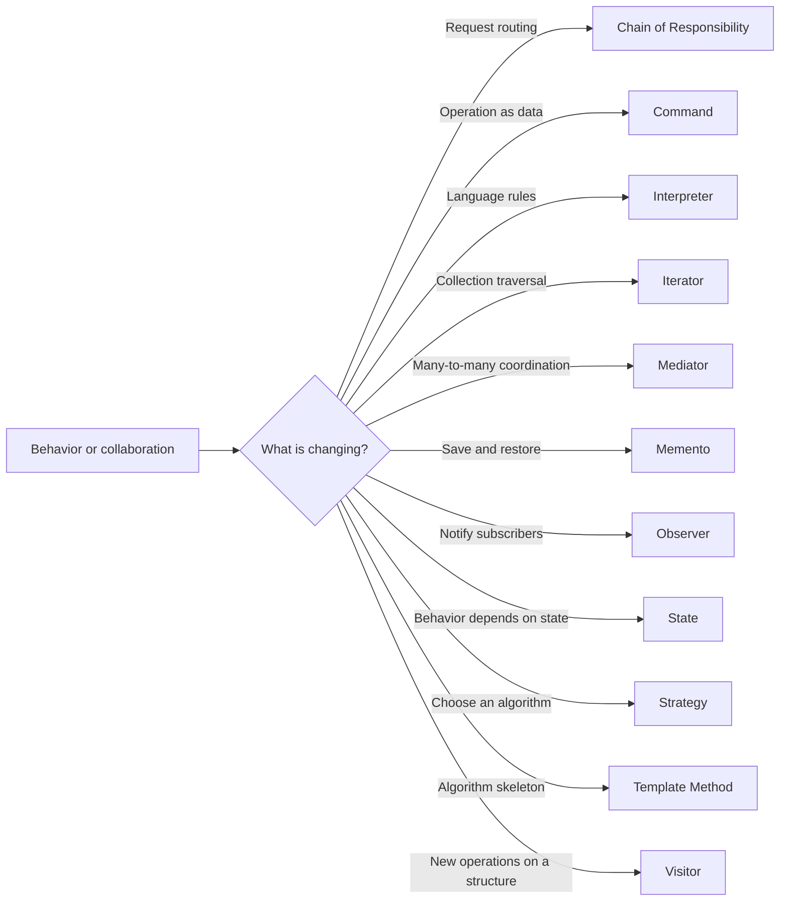

# 🤝 Behavioral Design Patterns

Behavioral patterns help objects **communicate, share responsibility, and
vary behavior** without becoming tangled together.

| Pattern | Chapter |
| --- | --- |
| Chain of Responsibility | [Guide and example](chain-of-responsibility/README.md) |
| Command | [Guide and example](command/README.md) |
| Interpreter | [Guide and example](interpreter/README.md) |
| Iterator | [Guide and example](iterator/README.md) |
| Mediator | [Guide and example](mediator/README.md) |
| Memento | [Guide and example](memento/README.md) |
| Observer | [Guide and example](observer/README.md) |
| State | [Guide and example](state/README.md) |
| Strategy | [Guide and example](strategy/README.md) |
| Template Method | [Guide and example](template-method/README.md) |
| Visitor | [Guide and example](visitor/README.md) |

Return to the [complete 23-pattern collection](../README.md). Each example is
an independent module with tests. Run all tests from the repository root with
`./gradlew test`, or run one pattern with
`./gradlew :behavioral:strategy:test`.
