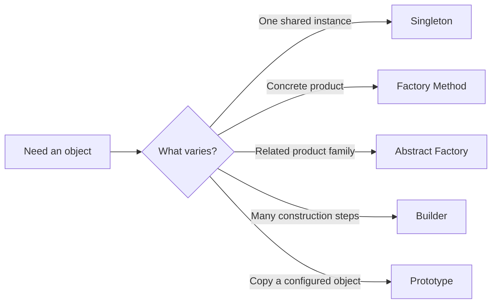

# 🎨 Creational Design Patterns

Creational patterns help decide **how and when objects are created**. They
hide construction details, select implementations, or build complex objects
without scattering `new` everywhere.

| Pattern | Chapter |
| --- | --- |
| Singleton | [Guide and example](dp-singleton/singleton.md) |
| Factory Method | [Guide and example](dp-factory/factory.md) |
| Abstract Factory | [Guide and example](dp-abstract-factory/abstract-factory.md) |
| Builder | [Guide and example](dp-builder/builder.md) |
| Prototype | [Guide and example](dp-prototype/prototype.md) |

Return to the [complete 23-pattern collection](../README.md). Each example is
an independent module with tests. Run all tests from the repository root with
`./gradlew test`, or run one pattern with
`./gradlew :creational:dp-singleton:test`.
