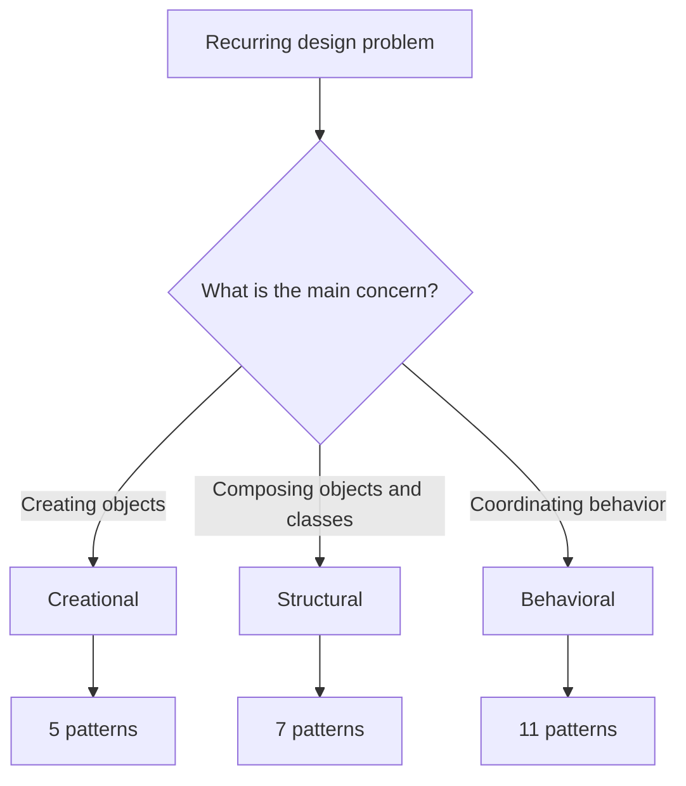

# 🛠️ Introduction to Design Patterns

Design patterns are reusable, well-understood approaches to recurring software
design problems. They are not copy-paste recipes or rules that every program
must follow; use them when they make a design easier to explain, change, and
test.

## Why learn patterns?

- **Shared vocabulary:** discuss a design using names other developers know.
- **Clearer trade-offs:** recognize what a design optimizes for and what it
  makes more complex.
- **Reusable reasoning:** start from proven structures rather than inventing
  every collaboration from scratch.
- **Better changeability:** many patterns isolate the part of a design that is
  likely to vary.

## The three GoF families

| Family | Focus | Examples |
| --- | --- | --- |
| [Creational](../creational/README.md) | Control object creation. | Factory Method, Builder |
| [Structural](../structural/README.md) | Compose objects and interfaces. | Adapter, Decorator |
| [Behavioral](../behavioral/README.md) | Coordinate algorithms and responsibilities. | Strategy, Observer |

Explore the [complete 23-pattern collection](../README.md). Every pattern has
a Java 21 implementation, guide, and focused tests. Spring Boot appears in
examples where it helps show a realistic application; otherwise the examples
stay framework-free so the pattern remains visible.
