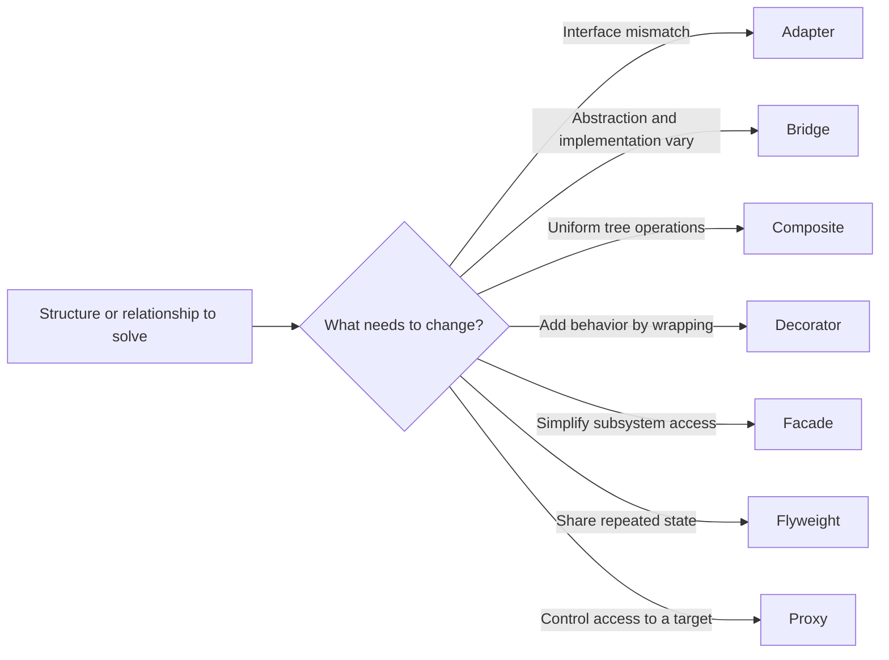

# 🧱 Structural Design Patterns

Structural patterns show **how objects and classes fit together**. Use them
to adapt incompatible interfaces, compose trees, wrap behavior, or control
access—without tying every part directly to every other part.

| Pattern | Chapter |
| --- | --- |
| Adapter | [Guide and example](adapter/README.md) |
| Bridge | [Guide and example](bridge/README.md) |
| Composite | [Guide and example](composite/README.md) |
| Decorator | [Guide and example](decorator/README.md) |
| Facade | [Guide and example](facade/README.md) |
| Flyweight | [Guide and example](flyweight/README.md) |
| Proxy | [Guide and example](proxy/README.md) |

Return to the [complete 23-pattern collection](../README.md). Each example is
an independent module with tests. Run all tests from the repository root with
`./gradlew test`, or run one pattern with
`./gradlew :structural:adapter:test`.
